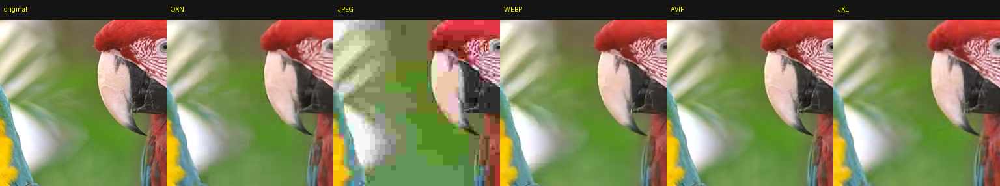

# OXN vs JPEG / WebP / AVIF / JPEG XL - benchmark

**Setup.** Kodak `kodim21–24` - these 4 images were **never used in training**
(honest holdout; the model was trained on BSDS500 + Kodak01–20 + DIV2K-valid).
Each codec is tuned to the same bitrate per image (nearest quality setting,
actual mean bpp shown). Metrics: PSNR, MS-SSIM, LPIPS(alex). Hardware:
RTX 4060 Laptop, Python/PyTorch implementation of OXN, reference encoders
via Pillow for the rest. OXN encode uses adaptive rate (best quality mode).

## PSNR (dB, higher is better)

| bpp | OXN | JPEG | WebP | AVIF | JXL |
|---|---|---|---|---|---|
| 0.15 | 26.85 | 21.45 | **28.51** | 27.79 | 27.13 |
| 0.20 | 26.29 | 22.87 | **28.18** | 29.24 | 27.15 |
| 0.25 | 27.04 | 25.42 | **28.98** | 29.24 | 27.72 |
| 0.30 | 27.26 | 27.15 | 29.29 | **30.14** | 28.87 |

## MS-SSIM (higher is better)

| bpp | OXN | JPEG | WebP | AVIF | JXL |
|---|---|---|---|---|---|
| 0.15 | **0.939** | 0.705 | 0.915 | 0.926 | 0.907 |
| 0.20 | **0.927** | 0.760 | 0.921 | 0.947 | 0.918 |
| 0.25 | **0.942** | 0.850 | 0.934 | 0.947 | 0.927 |
| 0.30 | 0.950 | 0.897 | 0.939 | **0.957** | 0.946 |

## LPIPS (lower is better)

| bpp | OXN | JPEG | WebP | AVIF | JXL |
|---|---|---|---|---|---|
| 0.15 | **0.203** | 0.468 | 0.235 | 0.268 | 0.315 |
| 0.20 | 0.259 | 0.403 | 0.229 | **0.203** | 0.315 |
| 0.25 | 0.240 | 0.286 | **0.191** | 0.203 | 0.295 |
| 0.30 | 0.230 | 0.213 | 0.180 | **0.156** | 0.226 |

## Speed (768×512, seconds per image)

| codec | encode | decode |
|---|---|---|
| OXN | 0.30 | 0.21 |
| JPEG | 0.001 | 0.001 |
| WebP | 0.02 | 0.003 |
| AVIF | 0.05 | 0.003 |
| JXL | 0.05 | 0.005 |

On a 201 MP photo OXN adaptive encode is ~110 s (GPU). CLI startup
(torch init + model load) adds ~10 s if the codec runs as a fresh process.

## OXN8-fast on ARM64 / NVIDIA GB10

Same 2880×2160 image, q50, before/after the native and adaptive optimizations:

| mode | stage | before | after |
|---|---|---:|---:|
| adaptive | encode | 11.07 s | **4.97 s** |
| flat | encode | 4.15 s | **2.18 s** |
| flat | decode | 3.51 s | **1.76 s** |

The flat bitstream is unchanged. The native library caches CDF/LUT tables,
replaces Python rANS and element-wise Q20.12 operations, batches the adaptive
decoder ladder and keeps reconstruction decoding in BF16 on CUDA. UI/viewer
model loading is reused between files. These timings are a local engineering
checkpoint.

## PICO v4 and Tiny v4 on ARM64 / NVIDIA GB10

These candidates use the separate 120799-image corpus described in `RESEARCH_IDEAS.md`;
Kodak21–24 and the user images are excluded from training. Metrics below are actual
rANS roundtrips, not training estimates.

| model / benchmark | bpp | PSNR | MS-SSIM | LPIPS |
|---|---:|---:|---:|---:|
| PICO v5 sparse 7k, Apple low-rate | 0.0947 | 30.342 | — | 0.2664 |
| PICO v5 sparse 7k, Kodak | 0.2007 | 23.844 | 0.8171 | 0.4061 |
| PICO v4 soup50, Kodak | 0.5000 | 27.535 | 0.9316 | 0.2207 |
| PICO v4 soup50, Kodak | 1.0008 | 29.500 | 0.9657 | 0.1282 |
| Tiny v4, matched Kodak | 0.1262 | 23.672 | 0.8279 | 0.4570 |
| Tiny v4 + boost, 201 MP | 0.1036 | 24.617 | 0.9954 | 0.0165 |

PICO v8 MoE final improves the screenshot holdouts again: 0.1999 bpp, 27.409 dB,
MS-SSIM 0.9407 and LPIPS 0.2926. On Apple scenes it averages 0.3193 bpp, 26.924 dB,
MS-SSIM 0.9144 and LPIPS 0.2748. All six target-bpp experts passed UI/viewer OXP9
roundtrips.

### PICO v8 MoE runtime optimization (ARM64 / GB10)

The OXP9 weights and rate gate are unchanged. GPU scale inference is now the default on
ARM/CUDA at all frame sizes; spatial phases use strided slices instead of mask transfers,
hyper/spatial entropy runs concurrently with GPU work, and RGB quantization happens before
the final uint8 copy to CPU. On the 4000×3000 q20 holdout (five measured runs after warmup):
encode **1.366 s** versus 2.07 s before, decode **0.946 s** versus 1.61 s, at 0.134012 bpp.
On the 201-MP q10 photograph: encode **22.313 s** versus 27.30 s and decode **14.169 s**
versus 21.08 s; bpp remains 0.0879519 and PSNR 20.459 dB, with 3.33 GiB peak process RSS.
All four Apple-scene streams remained byte-identical; their PSNR/MS-SSIM/LPIPS changes were
only at the last shown decimal places. All six experts, old OXP6/OXP7/OXP8/OXP9 streams and
the FP64 path passed roundtrips. Results: `data/eval/pico_v8_moe6_speed_12mp.json`,
`data/eval/pico_v8_moe6_speed_201mp.json`, and `data/eval/pico/v8_moe6_speed_apple.json`.

PICO v5 sparse also improves the three screenshot holdouts simultaneously: 0.2019 bpp,
26.825 dB, MS-SSIM 0.9363 and LPIPS 0.2974, versus 0.2372 bpp, 25.902 dB,
0.9141 and 0.3735 for PICO v4. Its 201-MP OXP7 roundtrip used 0.1651 bpp and
completed with 3.10 GiB peak process RSS.

Tiny v4 scale boost reduces Kodak encode from 0.232 to 0.126 s. On the 201-MP holdout
it reduces encode from 35.8 to 16.8 s and decode from 21.3 to 17.0 s, while also
slightly reducing bpp and LPIPS. OXP6/OXNV select the new checkpoints explicitly;
legacy OXP5/OXNT files continue to use their original models.

## OXN9 tiny quality experiment

The local `oxn9-tiny` branch uses 195,043 parameters instead of 17,123,051
(87.8× fewer), including a convolutional refinement head against patch seams.
The initial 4,000-step model was fine-tuned for 40,000 steps on Kodak01–20 plus
available local photographs, jointly with the context model and MS-SSIM/Sobel
losses. Kodak21–24 were never used in training.

Mean adaptive OXN9 results on that four-image holdout:

| q | initial bpp | retrained bpp | initial PSNR | retrained PSNR | initial MS-SSIM | retrained MS-SSIM |
|---|---:|---:|---:|---:|---:|---:|
| 25 | 0.087 | 0.116 | 21.13 | **22.64** | 0.692 | **0.849** |
| 50 | 0.102 | 0.117 | 21.46 | **22.65** | 0.731 | **0.849** |
| 75 | 0.128 | 0.126 | 21.63 | **22.73** | 0.759 | **0.856** |
| 92 | 0.147 | 0.136 | 21.69 | **22.78** | 0.771 | **0.861** |

Every candidate stream passed `--verify`; the installed model also passed a fresh
CPU-only decode of a GPU-produced file. Reconstruction pixels can differ slightly
between GPU BF16 and CPU FP32, while the entropy stream remains deterministic.

## OXN10 one-shot entropy experiment

OXN10 reuses the OXN8 autoencoder and moves residual-center prediction to GPU,
allowing all rANS streams to be decoded before context reconstruction. PSNR is
identical to OXN8 at the same scale map, but the fixed hyperprior Gaussian width
costs bitrate. Mean adaptive results on Kodak21–24:

| q | OXN8 bpp | OXN10 initial bpp | OXN10 after 40k bpp | PSNR |
|---|---:|---:|---:|---:|
| 25 | 0.1638 | 0.1751 | 0.1760 | 25.88 dB |
| 50 | 0.1776 | 0.1883 | 0.1897 | 26.41 dB |
| 75 | 0.2175 | 0.2368 | 0.2390 | 27.03 dB |
| 92 | 0.2495 | 0.2897 | 0.2929 | 27.24 dB |

Training the center offsets for 40,000 steps did not improve the actual bucketed
rANS rate, so the initial OXN7-initialized context remains the selected OXN10
checkpoint; the 40k candidate is retained only in `data/eval/oxn10/`.

Warm-process decode on the same 4000×3000 photograph at q100 (five-run median):

| model | bpp | PSNR | decode |
|---|---:|---:|---:|
| OXN8 | 0.3169 | 23.02 dB | 2.444 s |
| OXN10 initial | 0.4179 | 23.02 dB | **1.232 s (1.98× faster)** |
| OXN9 tiny | 0.1420 | 19.73 dB | 0.966 s |

Thus OXN10 remains CLI-only: its speedup does not justify the 7–32% bitrate
overhead as a default. Adaptive and flat streams passed `--verify`; a fresh
CPU-only process, the UI decoder and the standalone viewer accepted OXNA files.

## OXN11 spatial one-shot sigma

The OXN11 scale network predicts spatially varying log-sigma once from hyperprior
features and the scale map. Integer Q20.12 inference keeps bucket selection
identical across GPU and CPU. Mean adaptive Kodak21–24 results:

| q | OXN8 bpp | OXN10 initial bpp | OXN11 bpp | OXN11 vs OXN8 |
|---|---:|---:|---:|---:|
| 25 | 0.1638 | 0.1751 | **0.1685** | +2.8% |
| 50 | 0.1776 | 0.1883 | **0.1850** | +4.2% |
| 75 | 0.2175 | 0.2368 | **0.2306** | +6.0% |
| 92 | 0.2495 | 0.2897 | **0.2657** | +6.5% |

PSNR remains identical to OXN8/OXN10. Per-channel-only sigma calibration,
12,000-step scale training and joint mu/sigma fine-tuning were all rejected after
measuring real bucketed rANS streams.

Same 4000×3000 q100 photograph, five-run warm decode median:

| model | bpp | PSNR | decode |
|---|---:|---:|---:|
| OXN8 | 0.3169 | 23.02 dB | 2.249 s |
| OXN11 | 0.3339 | 23.02 dB | **1.370 s (1.64× faster)** |

OXN11 therefore cuts the earlier OXN10 q100 overhead from 31.9% to 5.4%. It stays
CLI-only pending further rate improvement. Adaptive/flat `--verify`, fresh
CPU-only decode, old OXNA decode, OXN8 regression, UI and viewer checks passed.

## OXN12 table-aware 2×2 grid

Exact canonical rANS table cost with a straight-through Gaussian gradient gives a
small further reduction. The 2×2 grid uses four spatial phases over all 24
channels, so only three context passes remain. Mean adaptive Kodak21–24 bpp:

| q | OXN8 | OXN11 | OXN11 table-aware | OXN12 |
|---|---:|---:|---:|---:|
| 25 | 0.1638 | 0.1685 | 0.1678 | 0.1701 |
| 50 | 0.1776 | 0.1850 | 0.1841 | 0.1854 |
| 75 | 0.2175 | 0.2306 | 0.2293 | 0.2284 |
| 92 | 0.2495 | 0.2657 | 0.2641 | 0.2628 |

The grid slightly costs bitrate at low q but improves high q. On the same
4000×3000 q100 photograph, warm-process medians from one measurement run:

| model | bpp | PSNR | decode |
|---|---:|---:|---:|
| OXN8 | 0.3169 | 23.02 dB | 2.521 s |
| OXN11 | 0.3339 | 23.02 dB | 1.234 s |
| OXN12 | 0.3341 | 23.02 dB | **1.206 s (2.09× vs OXN8)** |

The 2×2 gain over OXN11 is only about 2%, so neither experiment replaces OXN8.
OXN12 passed adaptive `--verify`, fresh CPU-only decode, UI/viewer decode and
OXNA/OXNB compatibility checks.

## OXN13 grouped 2×2 context

Two 12-channel groups restore causal cross-channel information without changing
the spatial sigma network. Mean adaptive Kodak21–24 results:

| q | OXN8 bpp | OXN12 bpp | OXN13 refined bpp | OXN13 vs OXN8 |
|---|---:|---:|---:|---:|
| 25 | 0.1638 | 0.1701 | **0.1669** | +1.9% |
| 50 | 0.1776 | 0.1854 | **0.1759** | **−0.9%** |
| 75 | 0.2175 | 0.2284 | **0.2201** | +1.2% |
| 92 | 0.2495 | 0.2628 | **0.2605** | +4.4% |

OXN13 performs one encoder-side refinement using actual canonical table costs at
the current context centers and widths. At q50 this is 4.1% smaller than the
initial OXN13 allocation; mean PSNR changes by −0.22 dB because the scale map is
different. At q75 the PSNR change is −0.06 dB. The original allocation remains at
q100, where refinement increased size.

At 4000×3000 q100 OXN13 uses 0.3312 bpp (+4.5% over OXN8), decodes in 1.288 s
and preserves 23.02 dB PSNR. Q20.12 quantization-aware scale fine-tuning was
rejected after a consistent 0.3–0.4% bitrate regression. OXN13 passed `--verify`,
fresh CPU-only decode, UI/viewer and OXNA/OXNB/OXNC compatibility checks.

## OXN14 empirical rANS tables

Empirical residual frequencies were collected only from Kodak01–20 at
q25/50/75/92/100, smoothed with a 100,000-count prior and normalized to RT=4096.
The OXN13 model is unchanged. Honest holdout results on Kodak21–24:

| q | OXN8 bpp | OXN13 refined | OXN14 bpp | OXN14 vs OXN8 |
|---|---:|---:|---:|---:|
| 25 | 0.1638 | 0.1669 | **0.1561** | **−4.7%** |
| 50 | 0.1776 | 0.1759 | **0.1670** | **−6.0%** |
| 75 | 0.2175 | 0.2201 | **0.2129** | **−2.1%** |
| 92 | 0.2495 | 0.2605 | **0.2518** | +0.9% |

Mean OXN14 PSNR is 25.84/26.29/27.01/27.24 dB at q25/50/75/92. Differences from
OXN8 come only from the adaptive scale map, since the autoencoder is unchanged.

At 4000×3000 q100 OXN14 uses 0.3246 bpp versus 0.3169 for OXN8 (+2.4%), with
23.02 dB PSNR and 1.492 s decode versus 2.485 s (1.66×). Native C and pure-Python
rANS produced identical bytes; fresh CPU-only, UI/viewer and OXNA–OXNC checks
passed.

## External matched-bpp checkpoint (OXN14)

`bench_external.py` compares Kodak21–24 against FFmpeg libjxl (effort 7) and
libaom AVIF (cpu-used 6, YUV444), selecting the closest actual bitrate per image.
Metrics are PSNR, the codec's MS-SSIM implementation and AlexNet LPIPS. OXN timings
are warm in-process; external timings include FFmpeg process startup.

| q | codec | bpp | PSNR | MS-SSIM | LPIPS ↓ | decode |
|---|---|---:|---:|---:|---:|---:|
| 50 | OXN14 | 0.1670 | 26.29 | **0.9272** | **0.3282** | **0.077 s** |
| 50 | JPEG XL | 0.1792 | 26.72 | 0.9102 | 0.3910 | 0.122 s |
| 50 | AVIF | 0.1515 | **28.54** | 0.9209 | 0.3345 | 0.104 s |
| 75 | OXN14 | 0.2129 | 27.01 | **0.9429** | 0.3040 | **0.074 s** |
| 75 | JPEG XL | 0.2102 | 27.32 | 0.9207 | 0.3508 | 0.117 s |
| 75 | AVIF | 0.2129 | **29.74** | 0.9408 | **0.2754** | 0.085 s |

This is not an overall win: AVIF leads PSNR at both points and LPIPS at q75,
while OXN14 leads MS-SSIM and decode time at q75. Visual crops also show OXN14
texture smoothing. See `data/eval/external/visual_q75.png`.

A direct PICO round-trip is not currently reproducible from the [official
release](https://github.com/apple/ml-pico): it publishes CLIC reconstructions and
an interactive viewer, but no encoder/decoder implementation or model weights.
Published PICO numbers must not be mixed into this local table.

### PICO article images

`bench_pico.py` uses the official viewer's `reference.png`, `pico.png` and
reported per-scene bpp. OXN14 quality is selected to approach the same bpp; no
PICO bitstream or runtime is inferred. Metrics use the same original image:

| scene | PICO bpp | OXN14 bpp | PSNR PICO / OXN | MS-SSIM PICO / OXN | LPIPS PICO / OXN ↓ |
|---|---:|---:|---:|---:|---:|
| philipp-reiner-207 | 0.341 | 0.2462 (q100 limit) | 25.27 / 24.85 | 0.9542 / 0.9278 | **0.0597 / 0.3689** |
| b1400e99… | 0.095 | 0.0950 | **34.89 / 32.50** | **0.9900 / 0.9825** | **0.0162 / 0.1199** |
| alexander-shustov-73 | 0.507 | 0.3584 (q100 limit) | 25.47 / 23.18 | 0.9612 / 0.9290 | **0.0611 / 0.3324** |
| kodim23 | 0.217 | 0.2171 | **32.57 / 30.75** | **0.9735 / 0.9682** | **0.0277 / 0.1545** |

PICO wins clearly on perceptual quality at matched bpp. OXN14's smaller size on
two scenes is not a ratio victory: it is already at q100 and cannot reach the
PICO rate/quality point. Visual comparison is in `data/eval/pico/visual.png`.

### Residual booster prototype (rejected)

`oxn_booster.py` implements an OXNF wrapper around OXN14 with spatial and
Haar-wavelet residual boosters and agreement gating. A full-resolution encoded
residual proved rate-inefficient during the smoke test (5.86 bpp on Kodak21 q75),
so the main ablation used boosted reconstruction without residual. After 4,000
steps on base-reconstruction crops, holdout q75 changed as follows:

| variant | bpp | PSNR | MS-SSIM | LPIPS ↓ |
|---|---:|---:|---:|---:|
| OXN14 | 0.2129 | **27.009** | **0.94285** | **0.30397** |
| OXNF booster | 0.2133 | 26.991 | 0.94279 | 0.30531 |

Spatial-only, wavelet-only, ungated average and gated variants all had lower PSNR.
On matched-bpp Kodak23, OXNF also slightly trailed OXN14 (LPIPS 0.1560 vs 0.1553).
The post-hoc booster is therefore rejected. A future model needs joint training
with the base codec, not an independently trained post-processing stage.

### Joint OXN-MR and sparse wavelet prototypes (rejected)

`oxn_mr.py` implements jointly trained YCoCg coarse-to-fine models with a shared
reconstruction block, hyperprior, exact discrete rate loss and scalable levels.
Actual OXM1/OXM2 streams passed entropy verification. Holdout q75 results:

| model | bpp | PSNR | MS-SSIM | LPIPS ↓ |
|---|---:|---:|---:|---:|
| OXN14 | **0.2129** | **27.009** | **0.94285** | **0.30397** |
| MR1, noise rate proxy | 1.1194 | 26.823 | 0.93951 | 0.42369 |
| MR2, exact discrete rate | 1.5638 | 27.468 | 0.94889 | 0.36784 |
| MR3, scalable `/16+/8` | 0.5919 | 26.175 | 0.92416 | 0.48320 |
| MR4, coarse-only, stronger rate | 0.3790 | 24.286 | 0.87284 | 0.58198 |

Per-image channel-wise RD optimization reduced MR3 on Kodak23 from 0.5123 to
0.3978 bpp with PSNR 28.66→28.44 dB, but did not close the gap. These MR variants
are not candidates for the default codec.

`oxn_wave.py` tested a sparse three-level Haar pyramid with adaptive rANS. Its
best initial Kodak23 low-rate point was 0.4274 bpp / 26.88 dB, also well behind
OXN14 (0.1722 bpp / 30.29 dB), so it was not promoted either.

### Recurrent joint decoder and OXN15/16 entropy tables

A zero-init three-iteration shared refinement block was trained jointly with the
OXN14 decoder while encoder, hyperprior and context were frozen. At holdout q75:

The following rows use OXN16 best-of encoding on the same holdout at q75:

| model | bpp | PSNR | MS-SSIM | LPIPS ↓ |
|---|---:|---:|---:|---:|
| OXN14 base | 0.21173 | **26.987** | **0.94198** | 0.30529 |
| Rec1 perceptual | **0.20897** | 26.796 | 0.93581 | 0.20096 |
| Rec2, stronger LPIPS | 0.21012 | 26.760 | 0.93523 | **0.19032** |
| Rec1/Rec2 weight average | 0.20953 | 26.794 | 0.93602 | 0.19697 |
| MSE-only recurrent | 0.20976 | 26.918 | 0.93800 | 0.31966 |

Rec1 gives a 34.2% LPIPS reduction and 1.3% smaller files, with a 0.19 dB PSNR
trade-off. Rec2 further improves LPIPS but adds 0.55% bpp; Rec1 is preferred for
the compression-first objective. MSE-only did not improve PSNR and was rejected.
On official PICO images Rec1 improves OXN14 but does not beat PICO:
Highway at 0.095 bpp reaches 31.92 dB / LPIPS 0.0892 versus PICO 34.89 / 0.0162;
Kodak23 at 0.217 bpp reaches 30.44 / 0.1123 versus PICO 32.57 / 0.0277.
The conditional two-step rectified-flow experiment with two-noise agreement gating
was rejected: at q75 it produced 0.21163 bpp, 26.398 dB, MS-SSIM 0.92543 and LPIPS
0.21861, worse than Rec1 across all metrics. OXN17 is the auto-detecting Rec1 +
OXN16 combination (`OXNH`/`OXNI`), with the same numbers as Rec1 in the table.
A full round-trip on the 16384×12288 (201 MP) source photograph produced
4,755,176 bytes (0.18895 bpp) at 31.20 dB PSNR. Best-of encoding took 411 s;
automatic decoding succeeded without an explicit checkpoint. OXN17 fast uses
one encode with eight exact-RD scale-map passes: holdout q75 totals 41,208 bytes
versus 41,304 before refinement (−0.23%), with PSNR unchanged within 0.003 dB.
Sixteen passes gave no further gain. Gradient optimization of free latent values
was rejected: it added 0.315 dB PSNR but increased size by 2.67%.

OXN15 split empirical tables by the two channel groups. Standalone results were
mixed, so OXN16 encodes both OXN14 and OXN15 and stores the smaller stream.
Best-of reduced holdout bytes by 0.50% at q75 and 0.62% at q50 without making
any individual file larger. OXNG streams use the same reconstruction model.

### PICO architecture reimplementation (research baseline)

`oxn_pico.py` follows the public [CVPR 2026 paper and supplemental diagrams](https://openaccess.thecvf.com/content/CVPR2026/html/Tatwawadi_What_Matters_in_Practical_Learned_Image_Compression_CVPR_2026_paper.html).
It is not Apple code or weights. OXP2 uses real four-phase entropy streams and
exact empirical-table RD training. Holdout q75:

| checkpoint | bpp | PSNR | MS-SSIM | LPIPS ↓ |
|---|---:|---:|---:|---:|
| initial MSE | 0.7577 | 23.119 | 0.84186 | 0.57959 |
| exact-rate MSE2 | 0.5530 | 23.730 | 0.87901 | 0.53465 |
| perceptual+GAN | 0.6249 | 24.137 | 0.90283 | 0.41686 |
| compact, stronger rate | 0.5028 | 24.096 | 0.89452 | 0.44528 |
| OXN17 reference | **0.2090** | **26.796** | **0.93581** | **0.20096** |

The GAN phase improves perceptual quality but spends more bits; compact training
then reduces bitrate by 19.5% with similar PSNR. Matched-bpp comparison against
official PICO reconstructions (`bench_pico_reimpl.py`) remains unfavorable:
Kodak23 at 0.217 bpp gives 21.20 dB / LPIPS 0.539 versus PICO 32.57 / 0.028;
Highway cannot reach 0.095 bpp (0.186 at q1, 26.37 dB / 0.469 versus 34.89 /
0.016). The local model is a baseline, not a reproduction of PICO's results: the
paper uses a much larger training corpus, two-stage training and architecture
search. A fast official DIV2K download was unavailable, so the corpus limitation
is explicit rather than hidden.

## The flip side: size at matched quality

Same data, read the other way - how many bits do others need to match OXN?

| OXN operating point | to match it, you need |
|---|---|
| PSNR 26.85 @ 0.15 bpp | JPEG ~0.30 bpp (**2x bigger file**) |
| LPIPS 0.203 @ 0.15 bpp | JPEG XL does not reach it even at 0.30 bpp (0.226) |
| MS-SSIM 0.939 @ 0.15 bpp | JPEG XL ~0.30 bpp (0.946, ~2x bigger file) |

So at very low bitrates OXN keeps roughly JPEG XL / double-JPEG
perceptual quality at half the size of what those codecs need for the
same numbers.

## Visual comparison (0.20 bpp, crop)



Left to right: original, OXN, JPEG, WebP, AVIF, JXL.

## Takeaways

- **vs JPEG: OXN wins everywhere by a landslide** - +4…5 dB PSNR, MS-SSIM
  and LPIPS by a wide margin, and no blocking artifacts at all.
- **vs WebP:** WebP is ahead on PSNR; on LPIPS at ≤0.20 bpp OXN is
  comparable or better.
- **vs JPEG XL:** JXL is slightly ahead on PSNR, but **OXN is clearly better
  on LPIPS** at low bitrates (0.20–0.26 vs 0.30–0.32) - perceptually OXN
  keeps textures more natural while JXL tends to smooth.
- **vs AVIF:** AVIF wins overall on this set.
- **Speed is the honest price:** 30–300× slower encode and ~50× slower
  decode than reference C encoders. This is a Python/PyTorch research
  codec; archiving/batch use, not realtime.

## Reproduce

```bash
pip install pillow pillow-jxl-plugin pillow-avif-plugin lpips scikit-image torchmetrics
# images: Kodak kodim21-24
# Historical OXN4 encode (at commit 11bc847):
# python3 ox_neuro.py c in.png out.oxh --q <q> --adaptive
# Current adaptive OXN8 encode: python3 ox_neuro.py c in.png out.oxh --q <q>
# Current flat OXN8 encode: python3 ox_neuro.py c in.png out.oxh --q <q> --flat
# classics: PIL Image.save(..., quality=q) with nearest bpp match
```
